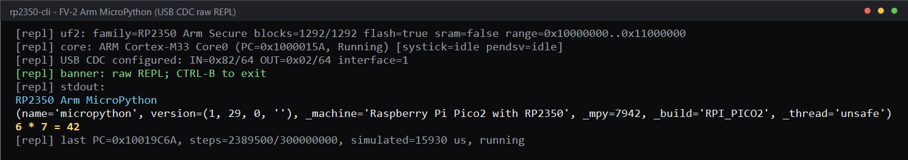
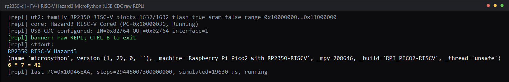
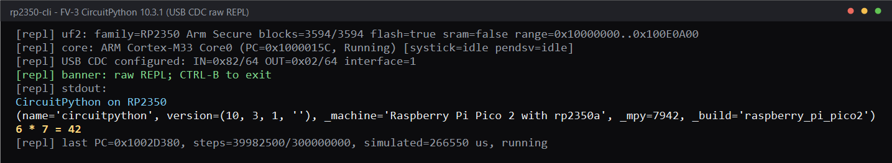
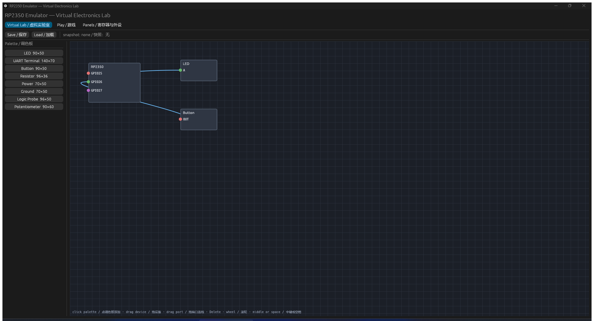

# rp2350-rs — RP2350 Emulator in Rust

[](https://github.com/Czlz/rp2350-rs/actions/workflows/ci.yml)
[](https://github.com/Czlz/rp2350-rs/actions/workflows/release.yml)
[](LICENSE)
[](doc/changelog.md)

> **EN**: A general, deterministic, instruction-accurate (cycle-approximate) emulator for the
> RP2350 microcontroller (Raspberry Pi Pico 2), implemented in Rust.
> **ZH**: 通用、确定性、指令精确（周期近似）的 RP2350 微控制器模拟器（树莓派 Pico 2）。

> **V1 范围**：精度声明、包含/不包含项、已知近似与验证矩阵见
> [`doc/v1-scope.md`](doc/v1-scope.md)。状态标记：✅ 已实现 · 🚧 部分实现（限制见范围声明）。

---

## Showcase / 成果展示

所有截图均来自本仓库当前代码的实际运行（生成命令见
[`doc/images/README.md`](doc/images/README.md)）。

### Real firmware → USB CDC raw REPL / 真实固件启动到 raw REPL

<table>
<tr>
<td width="33%"><b>FV-2 · Arm MicroPython 1.29.0</b><br>
</td>
<td width="33%"><b>FV-1 · RISC-V Hazard3 MicroPython 1.29.0</b><br>
</td>
<td width="33%"><b>FV-3 · CircuitPython 10.3.1</b><br>
</td>
</tr>
</table>

三份官方 UF2 都能在模拟器内完成启动、USB CDC 枚举、raw REPL 握手并执行客户机 Python：

| 门禁 | 固件 | 架构 | 结果 |
|---|---|---|---|
| FV-1 | `RPI_PICO2-RISCV-20260824-v1.29.0.uf2` | Hazard3 RV32IMAC | `6 * 7 = 42` |
| FV-2 | `RPI_PICO2-20260824-v1.29.0.uf2` | Cortex-M33 | `6 * 7 = 42` |
| FV-3 | `adafruit-circuitpython-...-10.3.1.uf2` | Cortex-M33 | `6 * 7 = 42` |

### pokeemerald on dual-core + HSTX / 双核 + HSTX 运行真实游戏

<table>
<tr>
<td width="62%"><b>emerald.uf2 @ 1.2 G steps — 240×160 RGB565 frame</b><br>
</td>
<td width="38%"><b>GUI 虚拟实验室 / Virtual Lab</b><br>
</td>
</tr>
</table>

- 双核：core0 跑游戏主循环，core1 跑软件 PPU 并驱动 HSTX；300 M 步基线
  `hstx words=5401204 underruns=0`、`core1 Running`。
- 帧缓冲 `0x20063DF4:240x160` 由 `run --dump` 导出后经
  [`example/gba/tools/fb2png.py`](example/gba/tools/fb2png.py) 转 PNG（无第三方依赖）。
- GUI 的「游戏」页可实时显示同一帧并映射键盘；「虚拟实验室」页展示设备调色板与拖线画布。

---

## Features / 特性

- ✅ **Arm Cortex-M33** — Thumb-16/32 解码、FPv5-SP FPU、NVIC/异常/SysTick、MPU 之外的特权寄存器
  （`MSPLIM`/`PSPLIM`）、FP 惰性压栈、GPIO(CP0)/DCP(CP4) 协处理器、DSP/SIMD 指令子集；
  真实双核 core0 + core1（SIO CPUID/FIFO/门铃、PSM 复位释放、每核 PPB 与中断路由）
- ✅ **RISC-V Hazard3** — RV32IMAC + Zcb（C 压缩）、machine CSRs、Xh3irq 外部中断、picobin 启动、
  真实 `wfi` 等待（单核；线程模式自动串行）
- ✅ **时钟树** — XOSC/ROSC、PLL_SYS/PLL_USB、`CLK_REF/SYS/PERI/USB/ADC/RTC` 源与分频；
  运行时超频/降频立即生效，`cycles→µs`、SysTick、TIMER、PIO CLKDIV、HSTX 像素时钟、
  UART 波特率、ADC/RTC、DMA 节拍全部跟随实时频率（不写死 150 MHz）
- ✅ **睡眠/异常语义** — `WFI`/`WFE`/`SEV`/`SEVL` + 事件寄存器、阻塞式 SIO FIFO 读与总线
  stall 重放、睡眠核快进、异常进入/返回与 `FAULTMASK`/`BASEPRI` 门控
- ✅ **USB 全链路** — 设备控制器模型 + 主机桥枚举 + raw REPL：真实 MicroPython UF2 可启动、
  进入 REPL，官方 `run-perfbench.py` 在 Arm/RISC-V 镜像上各 24/24 通过
- ✅ **存储** — 16 MB XIP Flash（`0x1000_0000`，含非缓存别名与维护窗口）、520 KB SRAM、
  合成 32 KB boot ROM、QMI/XIP 与 PSRAM 镜像窗口
- ✅ **DMA** — 16 通道、控制块、AL1/AL2/AL3 触发、byte/half/word、RING、CHAIN_TO、DREQ
  （PIO/UART/HSTX/定时器节拍）、abort、IRQ 0..3、sniffer（CRC32/CRC32R/CRC16/CRC16R/XOR/SUM）、
  `BUSCTRL` 性能计数器；仲裁为 64 步批量轮转（非逐周期抢占）
- ✅ **PIO** — 3 blocks × 4 SMs：9 类指令、autopush/autopull、wrap、stall、FIFO join、
  引脚/side-set/delay/CLKDIV、共享句柄、IRQ 路由、DMA DREQ 门控、
  `IO_BANK0.GPIOx_CTRL.FUNCSEL` 功能选通（`SIO`/`PIO0..2` 驱动 pad）与 PADS 电气模型
- 🚧 **HSTX** — APB 控制 + AHB FIFO、RAW/TMDS 命令、像素时钟节拍、宿主 drain/scanline、
  下溢 IRQ；**无** TMDS 10 位编码与 DVI 位时序（见 V1 范围声明）
- ✅ **音频** — I2S 采样捕获（`AudioSink`/`AudioTap`，CPU 与 DMA 共用 `Pio::push_tx`）+
  宿主播放后端（`cpal`，feature `playback`；无设备时 null 降级）
- ✅ **CLI** — `run`/`repl`/`play`/`perfbench`/`gdb`/`mcp-serve`/`list-devices`/`wire`；
  `--core-threads` 交互加速（非位可复现），默认确定性
- ✅ **GUI** — egui/eframe：PlayView（实时画面、键盘、音频状态、线程开关）+ 虚拟实验室
  （设备调色板、拖线连线、缩放/平移、状态保留）+ 寄存器/DMA/HSTX/PIO 面板
- ✅ **GDB RSP** — 协议层 + TCP 服务 + CLI 接线；R0–R15/XPSR、内存、断点、resume、
  写/读/访问监视点（`Z2`/`Z3`/`Z4`）、双核 `vCont`、`target.xml`；
  线程化执行器模式下不支持监视点
- ✅ **MCP** — JSON-RPC 方法层 + HTTP/1.1 传输（`POST /mcp`、`GET /health`）+ Bearer 鉴权；
  仅明文 HTTP（无 TLS）
- ✅ **插件系统** — libloading + abi_stable 动态加载 `.dll`/`.so`/`.dylib`，目录扫描、
  热重载、线程化执行器（固定 epoch 延迟）、LED 与 UART Terminal 第一方插件；
  `run --plugin-dir/--wire/--plugin-threads` 在 64 步泵送边界挂接真实运行（仅 `run`）

---

## Quick Start / 快速开始

```bash
# Build all crates
cargo build --release

# Run emulator with firmware (ELF) / 运行模拟器（ELF）
cargo run -p rp2350-cli -- run --file firmware.elf

# Boot a real MicroPython UF2 with boot trace / 启动真实 MicroPython UF2 并打印启动轨迹
cargo run -p rp2350-cli -- run --file RPI_PICO2-*.uf2 --arch arm --trace-steps 40

# RISC-V (Hazard3) firmware / RISC-V（Hazard3）固件
cargo run -p rp2350-cli -- run --file firmware.elf --arch riscv

# Boot real MicroPython and open its USB CDC raw REPL / 启动真实 MicroPython 并打开 raw REPL
cargo run -p rp2350-cli -- repl --file RPI_PICO2-*.uf2 --exec "print('hello')"

# Run a MicroPython performance benchmark / 运行 MicroPython 性能基准
cargo run -p rp2350-cli -- perfbench --file RPI_PICO2-*.uf2 --bench bm_fannkuch.py --benchrun benchrun.py

# Play a real game headless (frames + audio counters) / 无 GUI 逐帧运行真实游戏
cargo run -p rp2350-cli -- play --profile example/gba/profile.conf --frames 130

# Start the GDB RSP server / 启动 GDB RSP 服务器
cargo run -p rp2350-cli -- gdb --port 3333 --file firmware.elf

# List device plugins and create a wiring entry / 列出设备插件并建立接线
cargo run -p rp2350-cli -- list-devices --plugin-dir target/release
cargo run -p rp2350-cli -- wire --plugin-dir target/release --device com.rp2350-rs.led --port 0 --gpio 25

# Start the MCP HTTP server (POST /mcp, GET /health) / 启动 MCP HTTP 服务器
cargo run -p rp2350-cli -- mcp-serve --port 8080

# Run all tests / 质量门禁
cargo test --all-features
cargo fmt --all -- --check
cargo clippy --all-targets --all-features -- -D warnings -W clippy::pedantic
cargo doc --no-deps
```

---

## Project Structure / 项目结构

```
rp2350-rs/
├── crates/
│   ├── rp2350-core/              # address bus, memory regions, UF2/ELF loaders, MMIO, watchpoints
│   ├── rp2350-cpu/               # CPU abstraction traits (CpuCore, CpuState, CpuArch)
│   ├── rp2350-arm/               # Cortex-M33: Thumb-16/32, FPv5-SP, NVIC, exceptions, dual core
│   ├── rp2350-riscv/             # Hazard3: RV32IMAC + Zcb, machine CSRs, Xh3irq, picobin boot
│   ├── rp2350-bootrom/           # synthetic 32 KB boot ROM + host trap dispatch
│   ├── rp2350-periph/            # clocks, GPIO pads, timer, SIO, DMA, PIO, HSTX, USB, PSRAM, ADC/RTC
│   ├── rp2350-usb/               # USB device controller model (DPRAM, endpoint handshake, IRQ14)
│   ├── rp2350-usb-host/          # host-side bridge: enumeration, CDC, raw REPL, perfbench
│   ├── rp2350-audio/             # host audio backend (cpal behind the `playback` feature, null fallback)
│   ├── rp2350-virt-periph/       # DeviceManager, DevicePlugin, WiringTable, threaded executor, reload
│   ├── rp2350-plugin/            # Base plugin trait (RpPlugin, PluginContext, ABI exports)
│   ├── rp2350-ffi/               # SafeLibrary RAII wrapper (libloading)
│   ├── rp2350-gdb/               # GDB RSP: protocol layer, TCP server, target adapters
│   ├── rp2350-egui/              # egui GUI: PlayView, Virtual Lab canvas, peripheral panels
│   ├── rp2350-cli/               # CLI: run / repl / play / perfbench / gdb / devices / mcp-serve
│   └── rp2350-mcp/               # MCP Server: JSON-RPC methods + HTTP transport
├── plugins/
│   ├── led/                      # LED virtual device plugin (first-party)
│   └── uart-terminal/            # UART terminal plugin (bit-timed TX decode / RX encode)
├── example/gba/                  # pokeemerald-rp2350 example (profile, pin map, reports)
└── doc/                          # design documents, scope statement, changelog
```

---

## Platform Support / 平台支持

| Platform | Status | Notes |
|----------|--------|-------|
| Windows (x86_64) | ✅ Native | `.dll` plugin loading; V1 full verification host |
| Linux (x86_64) | ✅ Native (CI) | `.so` plugin loading |
| macOS (arm64/x86_64) | ✅ Native (CI) | `.dylib` plugin loading |
| Web (WASM) | ⏳ Post-V1 | Not in V1: the GUI links host-only crates (tokio full, libloading, file-system firmware loading) |

---

## Documentation / 文档

Full design documents in `doc/`:
- [V1 Scope & Accuracy](doc/v1-scope.md) — **发布口径**：包含/不包含、已知近似、确定性与线程模式、验证矩阵
- [Screenshots](doc/images/README.md) — README 截图与逐条复现命令（真实固件 REPL、GUI、游戏帧）
- [V1 Release Plan](doc/implementation-plan.md) — work packages, firmware gates and release checklist
- [Architecture](doc/architecture.md) — trait system, data flow, address space
- [Perfbench Report](doc/perfbench-report.md) — official `run-perfbench.py` results on the Arm and RISC-V MicroPython images
- [Playability](doc/playability-plan.md) — emerald throughput/frame rate, audio underrun accounting
- [Threading Plan](doc/threading-plan.md) — dual-core executor design, measurements, limits
- [Performance](doc/performance.md) — workload-window measurements and optimisation log
- [GBA Example](example/gba/README.md) — running `emerald.uf2` with core 1, HSTX scanout and a real game picture
- [USB Device Model](doc/usb-device-model.md) — USB device controller and host bridge design
- [Plugin Guide](doc/plugins.md) — how to create virtual device plugins
- [Lessons Learned](doc/lessons.md) — engineering pitfalls (measurement, concurrency, release hygiene)
- [Changelog](doc/changelog.md) — version history
- [API Reference](doc/crates/) — per-crate public API documentation

---

## License / 许可证

Licensed under either of:

- Apache License, Version 2.0 ([LICENSE-APACHE](LICENSE-APACHE))
- MIT license ([LICENSE-MIT](LICENSE-MIT))

at your option. See [LICENSE](LICENSE) for details.

---

## Acknowledgments / 致谢

- [rp2350js](https://github.com/c1570/rp2350js) — reference implementation for register maps and behavioral verification
- RP2350 Datasheet v1.1
- ARMv8-M Architecture Reference Manual
